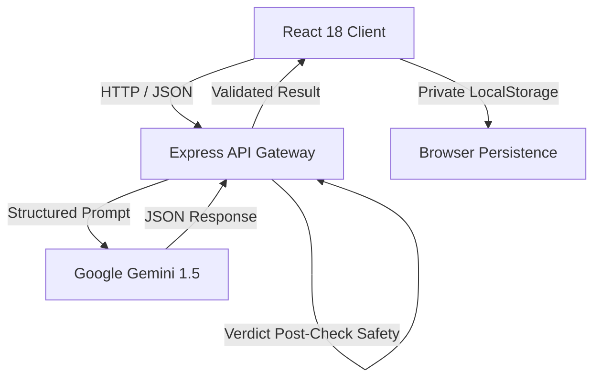

# BLINDSPOT AI — Decision Intelligence & Blind Spot Detector

> **"Every decision has a side you haven't seen."**  
> *See Beyond What You See.*  
> **Hackathon theme:** "The Blind Spot — Same decisions. A wider view."

BlindSpot AI is an intelligent thinking companion designed for students, recruiters, and professionals. It illuminates hidden assumptions, qualitative risk matrices, unstated priorities, and multi-stakeholder perspectives — **without ever deciding for the user**.

---

## ⚡ Quick 3-Step Setup

```bash
# 1. Clone & install root, client and server dependencies
npm install

# 2. Start both frontend & backend concurrently with one command
npm run dev

# 3. Open in your browser
http://localhost:5173/
```

*Note: No API key is required to explore the product! The app defaults to a full offline 60-second interactive demo.*

---

## 🛠 Feature Overview & Capabilities

| Capability | Powered By | Description |
| :--- | :--- | :--- |
| **Blind Spot Detection** | Gemini 1.5 + Zod | Categorizes non-obvious risks sitting outside your immediate decision frame. |
| **Unstated Assumption Scanner** | Gemini 1.5 + Zod | Exposes hidden premises in your reasoning that could fail under stress. |
| **Qualitative Risk Radar** | React 3x3 Grid | Maps likelihood vs impact on a qualitative grid (Low / Medium / High). |
| **Perspective Lab** | Gemini 1.5 + Zod | Simulates 5 stakeholder lenses (Recruiter, Mentor, Financial, Family, Future Self). |
| **What-If Simulator** | Gemini 1.5 + Zod | Stress-tests your decision under plot twists like stipend reductions or extra hours. |
| **Socratic Sparring Partner** | Gemini 1.5 + Zod | Interactive Socratic Q&A that respectfully pushes back on logic. |
| **Decision Journal** | LocalStorage | Tracks reflection history and decision quality over time. |

---

## 📐 System Architecture



---

## 🔍 How It Works

### 1. How the Frontend talks to the Backend
The React client communicates with the Express API gateway (`/api/analyze`, `/api/perspective`, `/api/simulate`, `/api/challenge/next`) using a typed API client service with automatic fallback to local demo data when offline or when no Gemini API key is configured.

### 2. How Gemini receives Decision Context
When a user submits a decision, Gemini receives structured prompt instructions along with untrusted user input enclosed in strict boundary delimiters to defend against prompt injection.

### 3. How Structured Output is Validated
All AI outputs are requested in raw JSON mode and validated on the Express server using strict **Zod schemas** (`AnalysisResultSchema`, `PerspectiveResultSchema`, etc.). If parsing fails, the system retries or falls back cleanly.

### 4. How LocalStorage Persistence Works
Decisions and reflections are saved locally in browser storage using a typed `LocalStorageProvider<T>` implementing a generic `StorageProvider<T>` interface. This decouples storage logic, making it ready for Firestore or database migration without touching UI code.

### 5. How Errors are Handled
Network timeouts, rate limits, and API failures are caught gracefully and surfaced via friendly inline `ErrorBanner` components.

### 6. How the System prevents AI from Making Decisions
BlindSpot AI enforces a non-prescriptive AI policy:
- System prompts strictly forbid verdict language ("you should accept/reject", "the best option is").
- Server-side middleware runs a post-check filter (`stripVerdicts`) on all Gemini output before returning it to the client.

---

## 🧪 Testing

Run tests for client and server:

```bash
# Run server test suite
npm run test:server

# Run client test suite
npm run test:client
```
